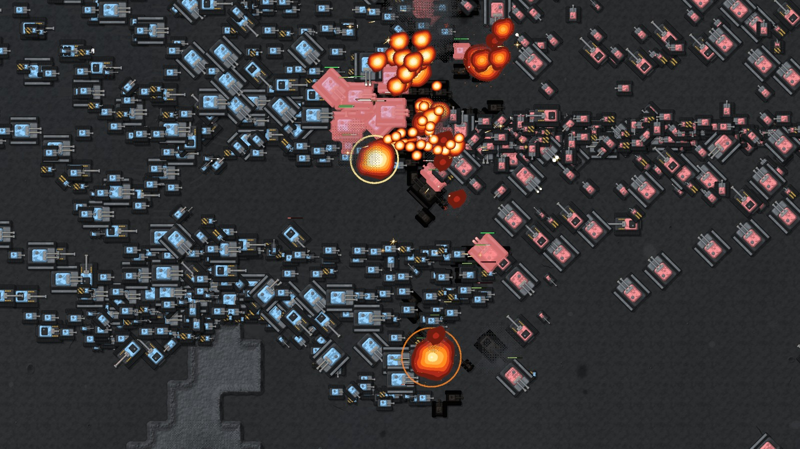
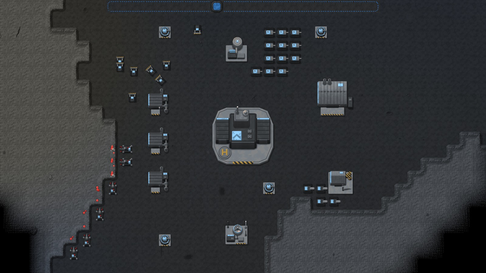
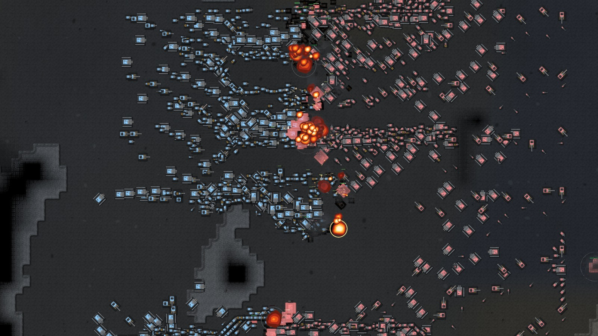

# WAR-2D

by [CoolCoder353](https://github.com/CoolCoder353)

> [!IMPORTANT]
> **This game is made by CoolCoder353. It is not Ryan's game.** This repository is a fork where Ryan helps with updates through pull requests. For the official project, go to the original repository: [CoolCoder353/WAR-2D](https://github.com/CoolCoder353/WAR-2D).

|  |  |
|:---:|:---:|
| A base, with Miners on gems and Builders starting a wall | A wider view of a battle that started with more than 1,000 units per side |

*Real captures from running matches on a generated 512-tile map, drawn by the game without its HUD. The bases and battles were set up for these captures with the game's dev tools.*

WAR-2D is a networked, top-down 2D real-time strategy game built in Unity. Two to eight players, free-for-all or in teams, each place a Headquarters (HQ) on a generated cave map. They mine gems, build walls, spawners, hidden bombs and Radars, dig through rock with Diggers, and send armies at each other's HQ. A player whose HQ falls is out, and the match is won when the players left no longer attack each other.

## Features

- 2 to 8 players, humans or AI seats (Easy, Normal or Hard, with play styles such as Rusher and Turtle)
- Generated maps of 256, 512 or 1024 tiles per side, with lanes and narrow chokepoints
- Up to 10,000 units per player
- Nine unit types, from Builders and Scouts to Artillery, Snipers and Suicide bombers
- Fog of war, teams and diplomacy
- Replays of each match, kept by the host

## Tech

- Unity `6000.4.1f1`
- Unity Entities (DOTS) `6.4.0`, with a 20 Hz simulation in Burst jobs
- Mirror networking, server-authoritative
- Online play through Steam (relay, lobbies, invites) with FizzySteamworks, and Direct (KCP) for tests and LAN
- Build profiles for Linux and Windows

## What Ryan is helping with

Ryan sends fixes and features to the original repository as pull requests, and CoolCoder353 decides what to take. See [Ryan's pull requests on the original repository](https://github.com/CoolCoder353/WAR-2D/pulls?q=is%3Apr+author%3ARyanWeera) for the current list and status.

## Getting started

Install Unity `6000.4.1f1`, the version pinned in `ProjectSettings/ProjectVersion.txt`. Open the project in Unity Hub and let the first import finish. Then open `Assets/Main_Menu.unity` and press **Play**.

- [docs/gameplay.md](docs/gameplay.md): rules, controls, buildings and units
- [docs/architecture.md](docs/architecture.md): how the code fits together
- [The original README](https://github.com/CoolCoder353/WAR-2D#readme): full setup, multiplayer, builds and tests

## Credits and licence

All credit for the game goes to [CoolCoder353](https://github.com/CoolCoder353).

The project has no licence file, so ask CoolCoder353 before any reuse. Vendored components (Mirror, DOTween, NaughtyAttributes, TIM Console, FizzySteamworks) keep their own licences.
